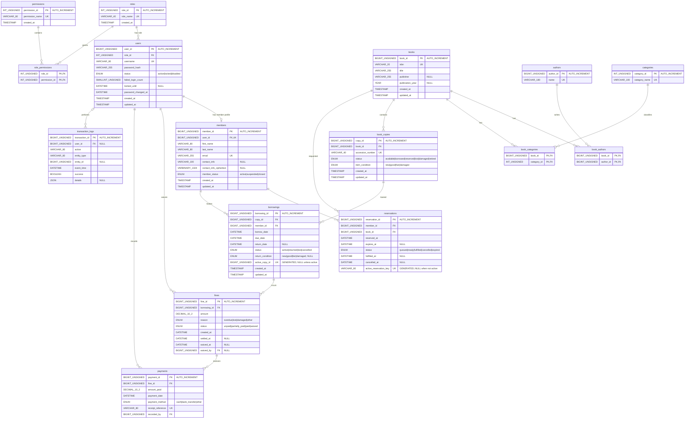

# LibraSys database ERD

This diagram and the notes below are derived from `database/01_schema.sql` and
`database/07_reservation_constraint_fix.sql`. The database is MySQL 8 with
`utf8mb4` / `utf8mb4_0900_ai_ci` defaults and InnoDB tables.

## Nullability, defaults, and generated values

- Every column is `NOT NULL` unless marked `NULL` above.
- Auto-increment primary keys are generated by MySQL.
- Defaults:
  - Timestamp/date audit fields use `CURRENT_TIMESTAMP`; `users.updated_at`,
    `members.updated_at`, `books.updated_at`, `book_copies.updated_at`,
    `borrowings.updated_at` also update automatically on row changes.
  - `users.status = 'active'`, `users.failed_login_count = 0`,
    `members.member_status = 'active'`, `book_copies.status = 'available'`,
    `book_copies.item_condition = 'good'`, `reservations.status = 'queued'`,
    `borrowings.status = 'active'`, `fines.status = 'unpaid'`, and
    `transaction_logs.success = TRUE`.
- `reservations.active_reservation_key` is a stored generated column:
  `CONCAT(member_id, ':', book_id)` only for `queued` or `ready`
  reservations, otherwise `NULL`. Its unique index allows one active
  reservation per member/book pair while preserving completed history.
- `borrowings.active_copy_id` is a stored generated column containing
  `copy_id` only while the borrowing is `active`, otherwise `NULL`. Its unique
  index allows at most one active borrowing per copy.

## Constraints and indexes

| Table | Constraints and indexes |
| --- | --- |
| `roles` | `role_name` unique |
| `users` | `fk_users_role`; `chk_users_failed_login (failed_login_count >= 0)`; `username` unique |
| `permissions` | `permission_name` unique |
| `role_permissions` | Composite primary key `(role_id, permission_id)`; foreign keys to `roles` and `permissions` |
| `members` | `fk_members_user`; `user_id` unique; `email` unique; `ix_members_name (last_name, first_name)` |
| `books` | `isbn` unique; `ix_books_title (title)`; full-text index `ftx_books_title (title)` |
| `authors` | `uq_authors_name (name)` unique |
| `book_authors` | Composite primary key `(book_id, author_id)`; foreign keys to `books` and `authors` |
| `categories` | `category_name` unique |
| `book_categories` | Composite primary key `(book_id, category_id)`; foreign keys to `books` and `categories` |
| `book_copies` | `fk_book_copies_book`; `accession_number` unique; `ix_book_copies_book_status (book_id, status)` |
| `reservations` | `fk_reservations_member`; `fk_reservations_book`; `uq_active_reservation (active_reservation_key)`; `ix_reservations_queue (book_id, status, reserved_at)` |
| `borrowings` | `fk_borrowings_copy`; `fk_borrowings_member`; `chk_borrowings_dates (due_date >= borrow_date)`; `uq_borrowings_one_active_copy (active_copy_id)`; `ix_borrowings_member_status (member_id, status)`; `ix_borrowings_copy_status (copy_id, status)`; `ix_borrowings_due_status (due_date, status)` |
| `fines` | `fk_fines_borrowing`; `fk_fines_waived_by`; `chk_fines_amount (amount > 0)`; `uq_fines_borrowing_reason (borrowing_id, reason)`; `ix_fines_status_created (status, created_at)` |
| `payments` | `fk_payments_fine`; `fk_payments_recorded_by`; `chk_payments_amount (amount_paid > 0)`; `receipt_reference` unique; `ix_payments_fine_date (fine_id, payment_date)` |
| `transaction_logs` | `fk_transaction_logs_user`; `ix_transaction_logs_user_time (user_id, event_time)`; `ix_transaction_logs_entity_time (entity_type, entity_id, event_time)` |

## Views

- `v_available_catalog`: every book with `book_id`, `isbn`, `title`,
  `publisher`, `publication_year`, and `available_copy_count`; the count is
  based only on copies whose status is `available`.
- `v_member_balances`: every member with `member_id`, `first_name`,
  `last_name`, `assessed_fines`, `paid_fines`, and `balance`. Waived fines are
  excluded; payments are summed per fine before calculating the balance.

## Trigger

- `trg_payments_no_overpayment` (`BEFORE INSERT ON payments`) locks the target
  fine, sums existing payments, and rejects the insert with SQLSTATE `45000`
  when the new payment would exceed the fine amount.
